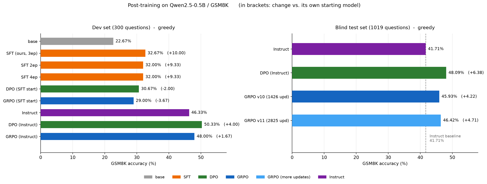
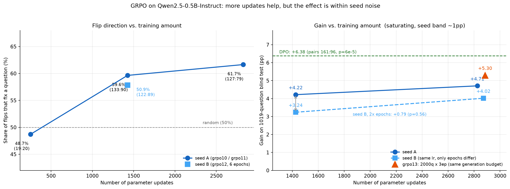

# 单卡后训练实践：Qwen2.5-0.5B 上的 SFT / DPO / 简化版 GRPO

在一张 24 GB 显卡（RTX 3090 / 4090）上，从零手写实现并对比三种后训练方法，目标是跑通完整闭环：
**数据构建 → 训练 → 评测 → 分析 → 迭代**。

所有方法均为手写实现（未使用 TRL/peft），所有结果均可在 CPU 上一条命令复算。

---

## 主要结果

评测集：GSM8K test 中 1019 道从未参与调参的题（与 300 题开发集不重叠）。贪心解码，抽取最终数字比对。

| 模型 | 起点 | 1019 题准确率 | 相对起点 | 改对/改错 | McNemar p |
|---|---|---|---|---|---|
| Qwen2.5-0.5B-Instruct | — | 41.71% | — | — | — |
| **+ DPO** | Instruct | **48.09%** | **+6.38** | 161 / 96 | 0.00006 |
| **+ GRPO**（seed A，1426 次更新） | Instruct | **45.93%** | **+4.22** | 133 / 90 | 0.0048 |
| + GRPO（seed C，2825 次更新） | Instruct | 46.42% | +4.71 | 127 / 79 | 0.0010 |
| + GRPO（seed B，1426 次更新） | Instruct | 44.95% | +3.24 | 122 / 89 | 0.0274 |
| + GRPO（seed B，2872 次更新） | Instruct | 45.73% | +4.02 | 128 / 87 | 0.0062 |
| **+ GRPO（2000 题×3 轮，2885 次更新）** | Instruct | **47.01%** | **+5.30** | 147 / 93 | 0.0006 |
| **+ GRPO（2000 题×3 轮，2857 次更新，seed2）** | Instruct | **46.71%** | **+5.00** | 136 / 85 | 0.0007 |
| SFT（从 base 自训） | Qwen2.5-0.5B | 32.67%（300 题） | +10.00 | — | — |



**一条命令复算上表：**

```bash
python verify.py
```

---

## 五个主要发现

### 1. DPO 与 GRPO 都需要足够强的起点

在自训 SFT 模型（32.67%）上，DPO 与 GRPO **都失效**（−2.00 / −3.67）；换到厂商对齐的 Instruct（41.71%）后，两者都显著为正。

机制：起点弱时大量题目的 k 次采样全错，组内奖励标准差为 0 被跳过，可学习的题太少，剩余更新方向被噪声主导。

### 2. GRPO 存在"无效 → 有效"的门槛，门槛之上呈平台



| 更新次数 | 翻转比（改对/总翻转） | p |
|---|---|---|
| 253 | 48.7%（等于抛硬币） | 1.0 |
| 1426 | 59.6% | 0.0048 |
| 2825 | 61.7% | 0.0010 |

**同 seed、同 lr、只把轮数翻倍（1426 → 2872）：+3.24 → +4.02，净 +8 题，p=0.56，不显著。**

而两个 seed 在相同配置下的差异是 0.98 个百分点。**训练量的效应（0.79）小于种子波动（0.98）** —— 说明在 1426 次更新之后，训练量已不是主导因素。

**跨方法的种子复现（共 10 个种子，无一为负，p 全部小于 0.03）：**

| 方法 | 种子数 | 各 seed 增益 | 标准差 |
|---|---|---|---|
| SFT | 3 | +10.00 / +11.00 / +9.00 | 1.00 |
| DPO | 3 | +6.38 / +5.30 / +4.41 | 0.99 |
| GRPO（500 题×6 轮） | 2 | +4.22 / +3.24 | 0.69 |
| GRPO（2000 题×3 轮） | 2 | +5.30 / +5.00 | **0.21** |

更新次数越多，种子方差越小（384 次 → 0.99，2857 次 → 0.21），方向一致但每个 GRPO 配置只有 2 个种子，不作定量结论。

### 3. 题库分配不是主导变量（相同生成预算下）

在**完全相同的生成预算**（6000 次访问 = 24000 个答案）下，把"500 题 × 12 轮"换成"2000 题 × 3 轮"：

| 配置 | 1019 题增益 | 相对另一组 |
|---|---|---|
| 500 题 × 12 轮 | +4.02 | — |
| **2000 题 × 3 轮** | **+5.30（p=0.0006）** | **+1.28（配对 p=0.35）** |

- grpo13 取得本项目 GRPO 的最佳结果，但相对 500×12 的 +1.28 个点**不显著**；
- 该差值（1.28）与种子波动（0.98）同量级 —— **本实验只能排除 2 个点以上的效应**；
- 训练统计上两组混合率几乎相同（48.1% vs 47.9%），但新题的全对率略高（28.3% vs 25.3%），即新增题目平均难度略低。

### 4. 同等预算下 DPO 更划算，但"谁的效果更好"尚不能判定

- DPO：离线采样约 3.1 h + 训练 10 min ≈ **3.5 GPU 小时**，得 +6.38
- GRPO（最佳）：6000 次在线访问 ≈ **9.5 GPU 小时**，得 +5.30

DPO 与最佳 GRPO 的逐题配对为 99 改对 / 110 改错（净 −11 题），**p=0.49，不显著**；与较弱的 GRPO（+4.71）配对时为 104/121，p≈0.29，同样不显著。
按 McNemar 样本量估算，要判定 1–1.7 个百分点的差距约需 4000–6000 道题；本项目只有 1019 道。

### 5. GRPO 的算力大部分花在生成上，且约一半生成被浪费

以 6000 次访问（9.5 小时）为例：

| 项 | 数量 |
|---|---|
| 生成回答 | 6000 × 4 = **24000 条** |
| 进入梯度更新（混合组） | 11488 条（**48%**） |
| 被丢弃（全对/全错组） | 12512 条（**52%**） |
| 参数更新本身耗时 | 不足总时间 5% |

对比 DPO：生成 12000 条（离线 3 小时）→ 筛出 1532 对 → 反复读 2 轮（384 次更新，10 分钟）。**DPO 的生成可复用，GRPO 的不能（on-policy）。**

---

## 方法论：三步诊断法

八次 GRPO 失败后，用三步区分"实现错误"与"预算不足"：

| 步骤 | 耗时 | 判据 |
|---|---|---|
| ① 梯度符号检查 | 1 分钟 | 对一道混合题做大 lr 更新，正确/错误答案的 logprob 差距是否扩大 |
| ② 过拟合检查 | 30 分钟 | 取 20–32 道题反复训练 20–30 遍，训练集准确率能否到 80% |
| ③ 剂量-反应检查 | 已有数据 | 训练量增加是否单调改善 |

**实测**：① 正确降 21.49、错误降 25.14，差距扩大 3.65 → 方向正确；② 32 题练 30 遍从 50% → 75% → 判定为预算问题；③ 253 次（0）→ 1426 次（+4.22）符合。

**副产品经验规则**：lr 的安全边界由"累计移动量 / 参数量级"决定。参数约 ±0.02 量级，累计移动（lr × 步数）超过其 50% 会崩、低于 5% 则无效。实测：lr 5e-5 × 320 步（80%）→ 准确率 0%；lr 5e-6 × 320 步（8%）→ 正常。

---

## 仓库结构

```
├── verify.py                  # 从逐题 dump 复算所有数字（CPU，无需 GPU）
├── src/
│   ├── sft/                   # 监督微调 + 数据清洗
│   ├── dpo/                   # 偏好数据构造 + DPO 训练
│   ├── grpo/                  # GRPO 训练 + reward
│   ├── eval/                  # 评测、逐题配对检验、投票评测
│   ├── diag/                  # 梯度检查、过拟合测试、四节链条诊断
│   └── data/                  # 题库扩充核查
├── docs/
│   ├── report.md              # 技术报告（约 3900 字）
│   ├── ablation.md            # 消融实验
│   ├── error-analysis.md      # 12 条错题归因
│   ├── why-grpo-weaker-than-dpo.md
│   └── experiment-log-grpo.md  # 扩题实验记录（grpo13）
└── results/
    ├── figures/               # 两张主图
    ├── dumps/                 # 逐题结果（idx / gold / pred / ok / len）
    └── logs/                  # 训练日志
```

---

## 快速开始

### 复算结果（无需 GPU）

```bash
python verify.py
```

输出包含每个模型相对基线的准确率差、改对/改错数、精确 McNemar p 值。

### 复现训练（单卡 24 GB）

```bash
# GRPO：500 题 × 6 轮，lr 2e-6，每步更新
python src/grpo/train_grpo.py \
  --model <path-to-Qwen2.5-0.5B-Instruct> \
  --n 500 --epochs 6 --accum_groups 1 \
  --lr 2e-6 --kl_weight 0 \
  --out ./out_grpo

# 评测
python src/eval/eval.py --model ./out_grpo --dump ./d.jsonl

# 逐题配对检验
python src/eval/compare_dumps.py <baseline_dump> ./d.jsonl
```

---

## 实现中修复的四个问题

| 问题 | 现象 | 修复 |
|---|---|---|
| **PAD 混入 logprob** | Qwen 的 `pad_token_id == eos_token_id`，尾部 padding 被算进损失 | 按第一个 EOS 截断 |
| **KL 项无拉回力** | 用 `(lp − lp_ref).mean()`（k1 估计量），梯度期望为 0 | 改用 k3 估计量 `expm1(d) − d` |
| **采样/打分温度不一致** | 采样用 T=0.8，打分用原始 logits（等价 T=1） | 打分时同样除以 T |
| **单步梯度噪声大** | 每步只用 1 个题组 | 可选梯度累积（`--accum_groups`） |

---

## 局限（如实记录）

1. **GRPO 的种子偏少**：SFT 与 DPO 各 3 个种子，GRPO 两个配置各 2 个（每个 run 需 4.7–9.5 GPU 小时），因此方差随更新次数减小的观察只作方向性结论。
2. **效应量与噪声同量级**：训练量翻倍（+0.79）、题库分配（+1.28）的效应都接近种子波动（0.98），**本实验只能排除 2 个点以上的效应**。
3. **样本量不足以判定方法差异**：DPO 与最佳 GRPO 差 1.08 个百分点（p=0.49），按样本量估算需 4000–6000 题。
4. **算力受限**：GRPO 最多 2885 次更新；两者训练预算未严格对齐。
5. **数据集单一**：仅 GSM8K，未涉及其他推理任务。
6. **模型规模单一**：0.5B，结论不能外推到 7B 以上。
7. **Instruct 的训练数据未知**：无法确认厂商是否见过 GSM8K 训练集；通过"评测集与训练集不重叠"部分缓解。
8. **错误分析样本小**：12 条，且题干截断后分类。

---

## 环境

- PyTorch 2.5.1 + CUDA 12.1，transformers 4.57.6
- 单卡 RTX 3090 / 4090（24 GB），bf16 全参训练
- 未使用 TRL、peft、DeepSpeed

> 踩坑记录：`trl` 升级会把 transformers 推到 5.x 导致 `torch` 被禁用（`NameError: name 'nn' is not defined`）；`hf-xet` 会在内网环境返回 401。最终固定 `transformers==4.57.6`、卸载 `hf-xet`、手写全部训练循环。
